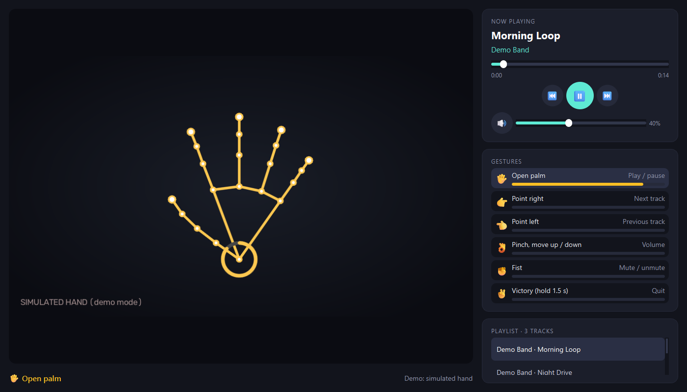
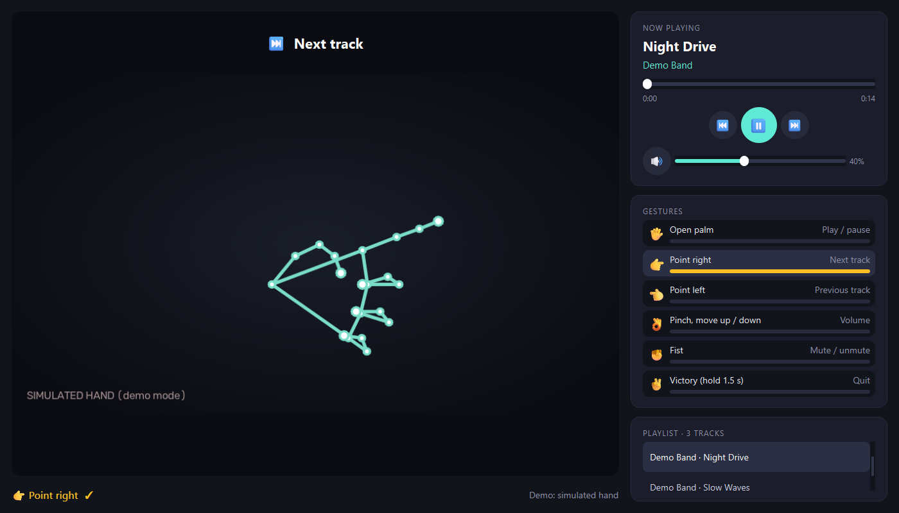
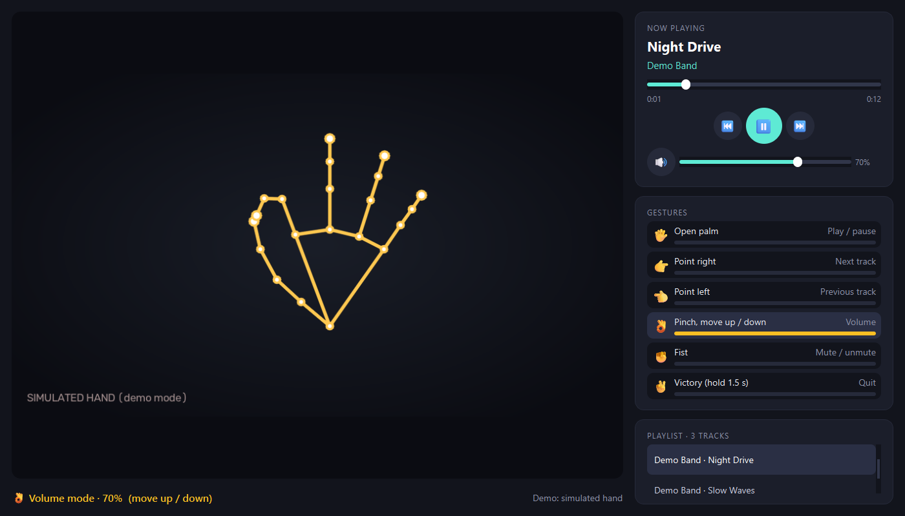
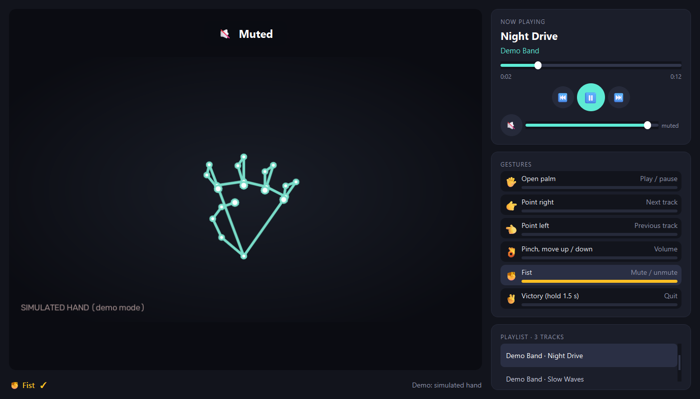

# ✋ Gesture Player

**Control your music with your hand: open your palm to play or pause, point to change track, pinch and move
up or down to set the volume. A desktop media player driven by a webcam, MediaPipe hand tracking and Qt.**



## Gestures

| Gesture | Action | How it fires |
|---|---|---|
| 🖐 Open palm | Play / pause | hold 0.45 s |
| 👉 Point right | Next track | hold 0.3 s |
| 👈 Point left | Previous track (or restart the current one after 3 s) | hold 0.3 s |
| 👌 Pinch, then move up / down | Volume, continuously | while pinching |
| ✊ Fist | Mute / unmute | hold 0.8 s |
| ✌️ Victory | Quit | hold 1.5 s |

A ring around the wrist and a bar in the legend fill up while a gesture is held, and a message confirms each action.

| Next track | Volume with a pinch | Mute |
|---|---|---|
|  |  |  |

*Screenshots use the built-in simulated hand (`--simulate`) and royalty-free demo tracks; with a webcam the skeleton
is drawn over your camera image.*

## How it works

```
webcam frame ─► MediaPipe Hand Landmarker ─► 21 landmarks ─► pose (one per frame) ─► tracker ─► player command
                                                              open palm, point,        hold, fire once,
                                                              pinch, fist, victory     re-arm on change
```

Design choices that make it pleasant to use:

- **Fires once.** A command triggers when its pose has been held for a moment, then waits until the hand changes
  pose: holding an open palm does not toggle play / pause in a loop, and pointing does not skip five tracks.
- **Works near or far, at any angle.** Every threshold is measured in "hand lengths" (wrist to middle knuckle),
  and a finger counts as extended when its tip is farther from the wrist than its middle joint, so a sideways
  pointing finger is read correctly.
- **No overlaps.** Poses are checked in a fixed priority order. A pinch requires the index to stay out (the 👌
  circle), which is what tells it apart from a fist, where the thumb also rests near the index.
- **Smooth volume.** The pinch's vertical movement, in hand lengths, maps to volume points, with fractions carried
  over so slow movements still count.
- **Tolerant tracking.** Losing the hand for a few frames does not cancel a gesture; quitting needs a deliberate
  1.5-second hold.

## Install and run

Requires Python 3.10+ and a webcam. No external player is needed: playback uses Qt Multimedia.

```bash
git clone https://github.com/<you>/gesture-player && cd gesture-player
python -m venv .venv && source .venv/bin/activate      # Windows: .venv\Scripts\activate
pip install -r requirements.txt

python -m gesture_player path/to/your/music     # webcam 0; the app asks for a folder if you omit it
python -m gesture_player --demo                 # royalty-free demo tracks, generated on first use
python -m gesture_player --demo --simulate      # no camera: watch a simulated hand use every gesture
```

Other options: `--camera 1` (another webcam), `--video clip.mp4` (a recorded video instead of the webcam),
`--no-mirror`, `--volume 40`. The hand model (7.8 MB) downloads automatically on the first run.
On Windows, if `pip` fails with a long-path error, create the virtual environment in a short folder (for example
`C:\venvs\gesture`) or enable long paths.

## Tests

```bash
pip install pytest && pytest -q
```

142 tests check every pose at three sizes, three angles and two camera formats, the fire-once and re-arm logic,
tracking-loss tolerance, pinch volume (independent of the distance to the camera) and the playlist parsing. They run
without a camera, Qt or MediaPipe, which is also how CI runs them.

## Project layout

```
gesture_player/
  hand.py        landmarks and scale-invariant geometry
  poses.py       one pose per frame, in priority order
  tracker.py     hold, fire once, re-arm, pinch volume
  detector.py    MediaPipe Hand Landmarker + skeleton drawing
  camera.py      capture thread: webcam, video file or simulated hand
  player.py      playlist playback with Qt Multimedia
  playlist.py    folder scan, natural order, "Artist - Title" parsing
  ui.py          the window          synthetic.py   simulated hands (tests and demo)
  demo_tracks.py royalty-free demo music           __main__.py    command line
tests/            142 tests
```

## Privacy

Camera frames are processed locally, in memory, and are never saved or sent anywhere. Your music folder is only read.

## Stack

Python · MediaPipe (Hand Landmarker) · OpenCV · PySide6 (Qt Widgets, Qt Multimedia) · NumPy · pytest · ruff ·
GitHub Actions

MIT licence.
